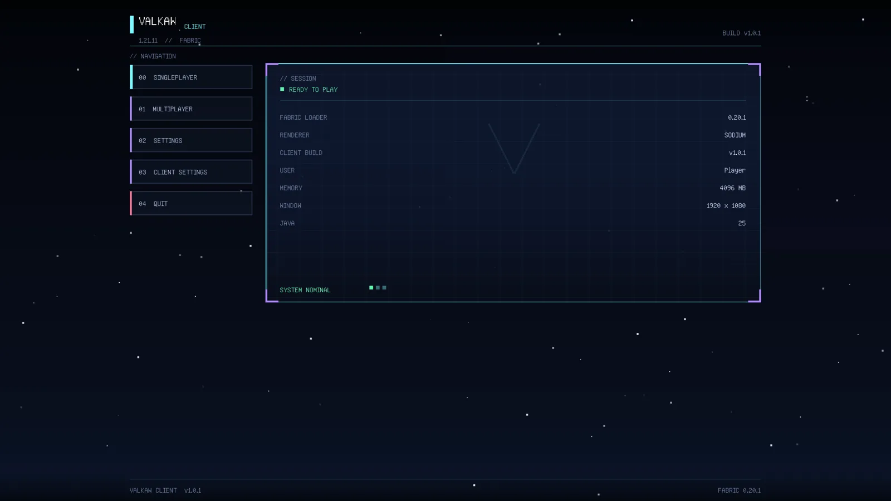
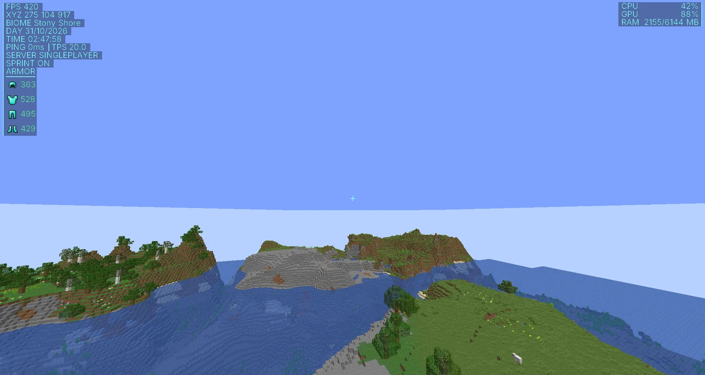
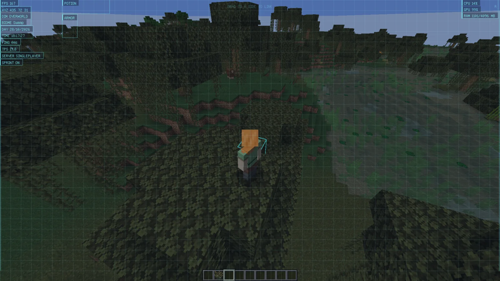

<div align="center">


# Valkaw Client

**A lightweight Fabric client for Minecraft Java 1.21.11 — plus the launcher that installs it.**

Two profiles ship from one source tree: **Sodium** for OpenGL and **VulkanMod** for Vulkan.
Modules cover HUD, performance and utility only — there is no combat, movement or server-side cheat.

[Releases](https://github.com/nlvtai25/valkaw-client/releases) · [Website](https://nlvtai25.github.io/valkaw-client/) · [License](LICENSE)

</div>

---

## Why Valkaw

- **One tree, two builds.** `src/` is shared; `build.gradle` decides which renderer and which optimisation mods are bundled. The Sodium and Vulkan jars are built from the same code.
- **Clean HUD, cheap to render.** 16 HUD modules, a 15×15 pixel Crosshair Editor, and the HUD editor (open by holding `F6`). No per-frame garbage in the render loop.
- **No cheat module.** Everything is HUD, performance or utility. No combat, movement or server-side hooks.
- **A launcher that handles the boring parts.** Installs the profile into `~/.valkaw/minecraft/<profile>/`, downloads a Java 21 runtime, and starts the game with tuned JVM flags.

## Download

Client jars come from [Releases](https://github.com/nlvtai25/valkaw-client/releases). Launcher binaries live in this repository:

| File | Platform |
| --- | --- |
| [valkaw-launcher-v1.0.8-linux-amd64](https://github.com/nlvtai25/valkaw-client/raw/main/assets/downloads/valkaw-launcher-v1.0.8-linux-amd64) | Linux |
| [valkaw-launcher-win-v1.0.8-windows-amd64.exe](https://github.com/nlvtai25/valkaw-client/raw/main/assets/downloads/valkaw-launcher-win-v1.0.8-windows-amd64.exe) | Windows |

Released client jars:

| File | What it is |
| --- | --- |
| [valkawclient-1.0.6-sodium.jar](https://github.com/nlvtai25/valkaw-client/releases/download/v1.0.6/valkawclient-1.0.6-sodium.jar) | Sodium profile client |
| [valkawclient-1.0.6-vulkan.jar](https://github.com/nlvtai25/valkaw-client/releases/download/v1.0.6/valkawclient-1.0.6-vulkan.jar) | Vulkan profile client |

## Preview

<div align="center">





</div>

## Modules

**HUD (16).** Armor, Combo, Coordinates, CPS, Crosshair, FPS, Keystrokes, PC Info, Ping, Potion, Server IP, Sneak, Speed, Sprint, Time, TPS.
Every HUD module can link to the left or right screen edge, and positions are dragged directly in the HUD Editor (hold `F6`).

**Performance (7).** Clear Fluids, Clouds, Memory Cleaner, Menu Backdrop, No Fog, Particles, Render Distance.

**Utility (15).** Auto Text, Better Tooltips, Block Outline, Chat Timestamps, Copy Chat, Copy Coords, Freelook, Fullbright, No Bobbing, No Fire, No Hurt Cam, No Pumpkin, Toggle Sneak, Toggle Sprint, Zoom.

Two extras sit outside the module lists. The **Custom Symbols** tab beside the chat input inserts Unicode symbols and `&` colour codes, handy when writing item names and lore. The **Crosshair Editor** draws a crosshair pixel by pixel on a 15×15 grid.

## Requirements

**Launcher (Linux):**

- x64 with GTK 3 and WebKitGTK 4.1: `libgtk-3-0 libwebkit2gtk-4.1-0`
- About 150 MB for the Java 21 runtime the launcher downloads on first setup

**Launcher (Windows):**

- Windows 10 or 11, 64-bit. The window is drawn with the WebView2 runtime, which ships with Windows 11 and with updated Windows 10. On a machine without it, install the Evergreen runtime from Microsoft first.
- About 150 MB for the Java 21 runtime the launcher downloads on first setup
- The exe is not code-signed, so SmartScreen warns once. Pick *More info* then *Run anyway*.

**Client, once installed:**

- JDK 21 or newer
- Fabric 1.21.11 (`loader 0.20.1`)
- An OpenGL 3.2 driver for the Sodium profile, a Vulkan 1.2 driver for the Vulkan profile
- An account with an offline username. Realms is not supported.

## Build the client

```sh
cd valkaw-client
./gradlew remapJar -Pvalkaw_variant=sodium
./gradlew remapJar -Pvalkaw_variant=vulkan
```

Output lands in `valkaw-client/build/libs/`. Both variants read the same `src/` tree, and `build.gradle` decides which renderer and which optimisation mods are bundled.

## Build the launcher

The launcher downloads the client jar from the latest release at install time, so it builds on its own. The Linux and Windows launchers share one Go core and one frontend.

```sh
cd valkaw-launcher
./build.sh                  # Linux binary in build/bin/
# or, without the Wails toolchain: go build -o build/bin/valkaw-launcher .

cd ../valkaw-launcher-win
./build.sh                  # Windows exe in build/bin/, built on any OS
```

`valkaw-launcher-win/build.sh` rebuilds the frontend in `valkaw-launcher/frontend`, copies the bundle, then cross-compiles with `wails build -platform windows/amd64`. Nothing else is needed on the machine: no Windows, no mingw.

## Layout

```
valkaw-client/       Fabric mod source, one tree, two build variants
valkaw-launcher/     Go + Wails launcher (Linux), shared core in core/
valkaw-launcher-win/ Windows shell: window, icon, build script
Website/              Vite + React marketing site, auto-deploys to GitHub Pages
```

## License

Apache License 2.0 — see [`LICENSE`](LICENSE). Bundled third-party mods keep their own licenses.
