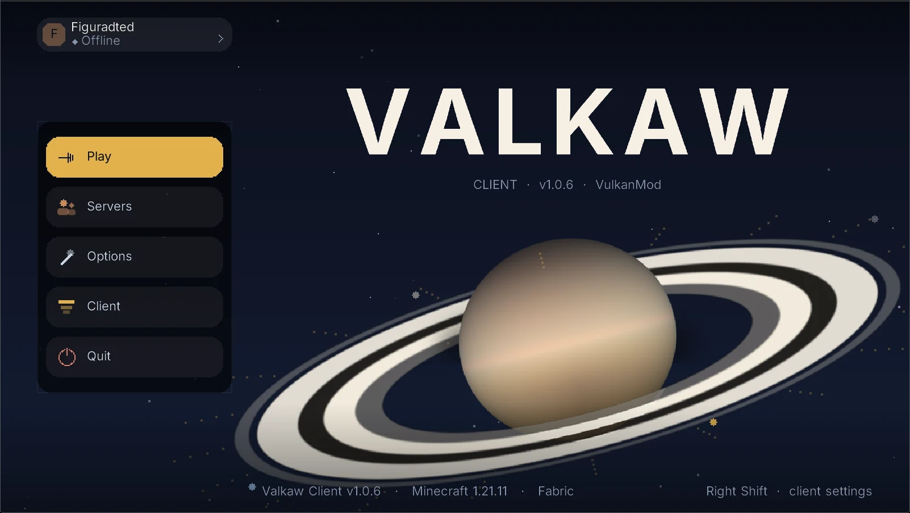
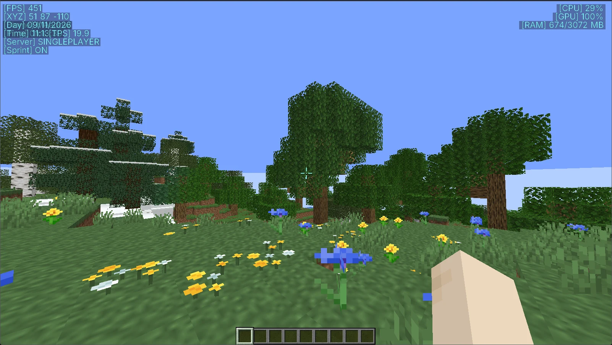
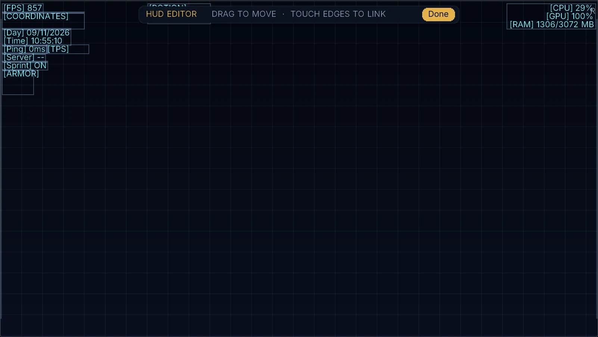

<div align="center">


# Valkaw Client

**A lightweight Fabric client for Minecraft Java — plus the launcher that installs it.**

One project, one source tree. The Fabric client ships as four version snapshots
(**1.21.11**, **26.1.2**, **26.2**, **26.3**), each with **Sodium** (OpenGL) and
**VulkanMod** (Vulkan) render profiles where the game version supports it. The
launcher builds as two binaries — **Linux** and **Windows** — from a shared Go
core and frontend, and installs whichever profile you pick.

Modules cover HUD, performance and utility only — there is no combat, movement
or server-side cheat.

[Releases](https://github.com/Confiactai25/valkaw-client/releases) · [Website](https://nlvtai25.github.io/valkaw-client/) · [License](LICENSE)

</div>

---

## Why Valkaw

- **One project.** Client and launcher live in the same repository and are versioned together.
- **Four client snapshots.** `1.21.11/` (sodium + vulkan), `26.1.2/` (sodium + vulkan), `26.2/` (sodium + vulkan), `26.3/` (sodium only). Each snapshot is a standalone source copy you can build with `scripts/build-version.sh`.
- **Two render profiles.** Sodium for OpenGL, VulkanMod for Vulkan — built from the same `src/` tree via `-Pvalkaw_variant=sodium|vulkan`.
- **Clean HUD, cheap to render.** 16 HUD modules, a 15×15 pixel Crosshair Editor, and the HUD editor (hold `F6`). No per-frame garbage in the render loop.
- **No cheat module.** Everything is HUD, performance or utility. No combat, movement or server-side hooks.
- **A launcher that handles the boring parts.** Installs the profile into `~/.valkaw/minecraft/<profile>/`, downloads a Java 21 runtime, and starts the game with tuned JVM flags. Builds for Linux and Windows from the same code.

---

## Download

Client jars come from [Releases](https://github.com/Confiactai25/valkaw-client/releases). Launcher binaries ship as release assets:

| File | Platform |
| --- | --- |
| valkaw-launcher-v1.0.9-linux-amd64 | Linux |
| valkaw-launcher-win-v1.0.9-windows-amd64.exe | Windows |

Released client jars:

| File | What it is |
| --- | --- |
| valkawclient-1.0.6-sodium.jar | Sodium profile client (MC 1.21.11) |
| valkawclient-1.0.6-vulkan.jar | Vulkan profile client (MC 1.21.11) |

Artifacts are named `valkaw-<profile>-<game-ver>-<client-ver>.jar` — see `version/README.md` for the full naming grammar and how the launcher resolves local builds.

---

## Preview

<div align="center">





</div>

---

## Modules

**HUD (16).** Armor, Combo, Coordinates, CPS, Crosshair, FPS, Keystrokes, PC Info, Ping, Potion, Server IP, Sneak, Speed, Sprint, Time, TPS.

Every HUD module can link to the left or right screen edge, and positions are dragged directly in the HUD Editor (hold `F6`).

**Performance (7).** Clear Fluids, Clouds, Memory Cleaner, Menu Backdrop, No Fog, Particles, Render Distance.

**Utility (15).** Auto Text, Better Tooltips, Block Outline, Chat Timestamps, Copy Chat, Copy Coords, Freelook, Fullbright, No Bobbing, No Fire, No Hurt Cam, No Pumpkin, Toggle Sneak, Toggle Sprint, Zoom.

Two extras sit outside the module lists. The **Custom Symbols** tab beside the chat input inserts Unicode symbols and `&` colour codes, handy when writing item names and lore. The **Crosshair Editor** draws a crosshair pixel by pixel on a 15×15 grid.

---

## Bundled mods

Each client jar nests its dependencies as jar-in-jar, so a single file carries everything. No resourcepacks are bundled; the client uses the vanilla textures.

<details>
<summary><strong>Universal</strong> — shared by both profiles</summary>

- [Fabric API](https://modrinth.com/mod/fabric-api)
- [Lithium](https://modrinth.com/mod/lithium)
- [Ferrite Core](https://modrinth.com/mod/ferrite-core)
- [Krypton](https://modrinth.com/mod/krypton)
- [Dynamic FPS](https://modrinth.com/mod/dynamic-fps)
- [BadOptimizations](https://modrinth.com/mod/badoptimizations)
- [Clumps](https://modrinth.com/mod/clumps)
- [C2ME](https://modrinth.com/mod/c2me-fabric)
- [ScalableLux](https://modrinth.com/mod/scalablelux)
- [Very Many Players (VMP)](https://modrinth.com/mod/vmp-fabric)
- [ModernFix (mVUS)](https://modrinth.com/mod/modernfix-mvus)
- [Ixeris](https://modrinth.com/mod/ixeris)
- [ImmediatelyFast](https://modrinth.com/mod/immediatelyfast)
- [Particle Core](https://modrinth.com/mod/particle-core)
- [EntityCulling](https://modrinth.com/mod/entityculling)
- [FastQuit](https://modrinth.com/mod/fastquit)
- [Ksyxis](https://modrinth.com/mod/ksyxis)
- [Greedy Meshing](https://modrinth.com/mod/greedy-meshing)
- [ResourcePackCached](https://modrinth.com/mod/resourcepackcached)
- [Offline Mode Fix](https://modrinth.com/mod/offline-mode-fix)
- [LambDynamicLights](https://modrinth.com/mod/lambdynamiclights)
- [Lightweight Inventory Sorting](https://modrinth.com/mod/lightweight-inventory-sorting)
- [Shulker Box Tooltip](https://modrinth.com/mod/shulkerboxtooltip)
- [Cloth Config](https://modrinth.com/mod/cloth-config) (dependency)
- [Fzzy Config](https://modrinth.com/mod/fzzy-config) (dependency)
- [Fabric Language Kotlin](https://modrinth.com/mod/fabric-language-kotlin) (dependency)

</details>

<details>
<summary><strong>Sodium profile</strong> — renderer and OpenGL extras</summary>

- [Sodium](https://modrinth.com/mod/sodium) (renderer)
- [Sodium Extra](https://modrinth.com/mod/sodium-extra)
- [Reese's Sodium Options](https://modrinth.com/mod/reeses-sodium-options)
- [MoreCulling](https://modrinth.com/mod/moreculling)
- [Chunks Fade In](https://modrinth.com/mod/chunks-fade-in)
- [Better Block Entities](https://modrinth.com/mod/better-block-entities)
- [Sodium FPS Cap Fix](https://modrinth.com/mod/sodiumfpscapfix)

</details>

<details>
<summary><strong>VulkanMod profile</strong> — renderer and Vulkan extras</summary>

- [VulkanMod](https://modrinth.com/mod/vulkanmod) (renderer)
- [Not Enough Vulkan](https://modrinth.com/mod/not-enough-vulkan)
- LWJGL Vulkan bindings (VMA, shaderc) — bundled from the VulkanMod jars

</details>

---

## Requirements

**Launcher (Linux):**

- x64 with GTK 3 and WebKitGTK 4.1: `libgtk-3-0 libwebkit2gtk-4.1-0`
- About 150 MB for the Java 21 runtime the launcher downloads on first setup

**Launcher (Windows):**

- Windows 10 or 11, 64-bit. The window is drawn with the WebView2 runtime, which ships with Windows 11 and with updated Windows 10. On a machine without it, install the Evergreen runtime from Microsoft first.
- About 150 MB for the Java 21 runtime the launcher downloads on first setup
- The exe is not code-signed, so SmartScreen warns once. Pick *More info* then *Run anyway*.

**Client, once installed:**

- JDK 21 or newer
- Fabric loader for the target game version (`0.20.1` for 1.21.11)
- An OpenGL 3.2 driver for the Sodium profile, a Vulkan 1.2 driver for the Vulkan profile
- An account with an offline username. Realms is not supported.

---

## Build the client

Client source lives in per-version snapshots: `1.21.11/valkaw-client/`, `26.1.2/valkaw-client/`, `26.2/valkaw-client/`, `26.3/valkaw-client/`. Build any snapshot with `scripts/build-version.sh` — artifacts land in `version/`:

```sh
./scripts/build-version.sh 1.21.11                    # sodium only
./scripts/build-version.sh 26.2 --profiles sodium vulkan
./scripts/build-version.sh 1.21.11 --profiles all --clean
```

The script reads `version=` from the snapshot's `gradle.properties`, picks `remapJar` (1.21.x) or `jar` (26.x), and copies the result to `version/valkaw-<profile>-<game-ver>-<client-ver>.jar`.

---

## Build the launcher

The launcher downloads the client jar from the latest release at install time, so it builds on its own. The Linux and Windows launchers share one Go core and one frontend.

```sh
cd valkaw-launcher
./build.sh                  # Linux binary in build/bin/
# or, without the Wails toolchain: go build -o build/bin/valkaw-launcher .

cd ../valkaw-launcher-win
./build.sh                  # Windows exe in build/bin/, cross-compiled from any OS
```

`valkaw-launcher-win/build.sh` rebuilds the frontend in `valkaw-launcher/frontend`, copies the bundle, then cross-compiles with `wails build -platform windows/amd64`. Nothing else is needed on the machine: no Windows, no mingw.

---

## Layout

```
valkaw-client/            (root symlink — see below)
valkaw-launcher/          Go + Wails launcher, shared core in core/
valkaw-launcher-win/      Windows shell: window, icon, build script
1.21.11/valkaw-client/    client source snapshot for MC 1.21.11
26.1.2/valkaw-client/     client source snapshot for MC 26.1.2
26.2/valkaw-client/       client source snapshot for MC 26.2
26.3/valkaw-client/       client source snapshot for MC 26.3 (sodium only)
version/                  built client jars (gitignored, see version/README.md)
Website/                  Vite + React marketing site, auto-deploys to GitHub Pages
scripts/build-version.sh  builds a client snapshot into version/
```

`valkaw-client/` at the repository root is a convenience link to the active client snapshot (currently `1.21.11/valkaw-client/`). Version-specific builds should use the numbered snapshot folders directly.

---

## License

Apache License 2.0 — see [`LICENSE`](LICENSE). Copyright 2026 Confiac1563. Bundled third-party mods keep their own licenses.
